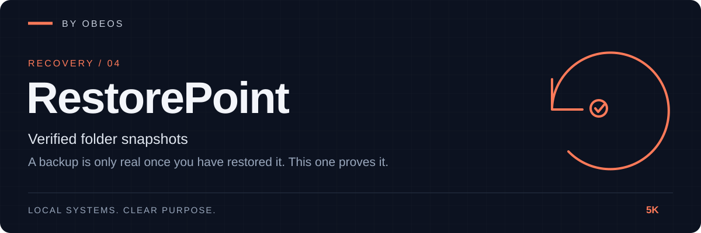

<div align="center">



**Verified folder snapshots. A backup is only real once you have restored it; RestorePoint proves it.**

[](https://github.com/5K-bit/RestorePoint/actions/workflows/ci.yml)


[](LICENSE)

</div>

[Quick start](#quick-start) · [Demonstration](#demonstration) · [Tests](#tests-and-evidence) · [Limitations](#limitations)

---

## Overview

RestorePoint takes **snapshots of a folder** into a local repository: data is split into chunks, **deduplicated**, compressed and named by its **SHA-256**. Every read is checked against that hash. `restorepoint verify --drill` goes further and **restores a snapshot to a scratch folder and compares it with the manifest**, so you learn that a backup works before the day you need it.

Part of the OBEOS projects, and it works completely on its own. No server, no account, no network access; the repository is a plain folder.

> **Your backups are unencrypted copies.** A repository holds your data readable by anyone who can read the folder. Keep it on storage you protect, and keep a second copy somewhere else: deduplication means one damaged chunk affects every snapshot that uses it. See [Limitations](#limitations).

## Demonstration

A real run on a synthetic accounts folder (generated by [`examples/acceptance.py`](examples/acceptance.py); the full transcript is in [docs/evidence](docs/evidence/acceptance-transcript.txt) and a test fails if it ever stops matching). The folder is snapshotted twice, then deleted:

```text
$ restorepoint snapshot accounts --label monday
snapshot 5658a61aa46d: 17 files, 5 folders, 4.3 MiB; 20 new chunks (<size> stored), 0 reused
$ restorepoint snapshot accounts --label tuesday
snapshot 2b75fa449b8a: 17 files, 5 folders, 4.3 MiB; 2 new chunks (<size> stored), 18 reused
$ restorepoint diff 5658a61aa46d 2b75fa449b8a
+ notes-tuesday.txt
- config/secrets.example
~ ledger/2026-12.csv

# Disaster: the whole folder is deleted
$ restorepoint restore latest recovered
restored 17 files (4.3 MiB), every file checked, to recovered
# recovered tree identical to the lost one: yes
$ restorepoint verify --drill latest
snapshots: 2  chunks checked: 22  unused chunks: 0
restore drill 2b75fa449b8a: 17 files, 4.3 MiB restored and compared
integrity: OK
```

Compressed sizes depend on the zlib build, so the recorded transcript shows them as `<size>`.

Then one stored chunk is damaged on disk. RestorePoint names it, refuses to hand back corrupt data, and still recovers everything that was not affected:

```text
$ restorepoint verify
PROBLEM: chunk d1337349e613 is corrupt (not valid compressed data)
integrity: FAILED                                    [exit 2]
$ restorepoint restore latest recovered-again
restorepoint: integrity failure: chunk d1337349e613 is corrupt (not valid compressed data)   [exit 2]
$ restorepoint restore latest just-ledgers --only ledger
restored 12 files (7.2 KiB), every file checked, to just-ledgers
# the untouched ledgers were recovered intact: yes
```

Reproduce it: `python examples/acceptance.py --out /tmp/evidence`.

## Quick start

**Requirements:** Python 3.11 or newer.

```bash
git clone https://github.com/5K-bit/RestorePoint && cd RestorePoint
pip install .                                    # no other dependencies
restorepoint --repo /mnt/backup/docs.rpstore init
restorepoint --repo /mnt/backup/docs.rpstore snapshot ~/Documents --label weekly \
    --exclude "*.tmp" --exclude "node_modules/"
```

Use it:

```bash
export RESTOREPOINT_REPO=/mnt/backup/docs.rpstore   # or pass --repo each time
restorepoint list                                    # ids, times, sizes
restorepoint diff <old-id> <new-id>                  # + added  - removed  ~ modified
restorepoint restore latest ~/restored               # into a NEW folder; never overwrites
restorepoint restore latest ~/one-file --only notes/plan.md
restorepoint verify --drill latest                   # re-read everything, then prove a restore works
restorepoint prune --keep-last 10                    # dry run; add --apply to delete
```

| Command | Purpose |
|---|---|
| `init` | Create an empty repository (refuses a non-empty folder) |
| `snapshot SRC [--label --exclude PATTERN --strict]` | Record a folder; unreadable files are reported and listed in the snapshot |
| `list` / `show ID [--files]` / `diff OLD NEW` | Inspect snapshots (`ID` is a prefix of 6+ characters, or `latest`) |
| `restore ID TARGET [--only PATH --links]` | Restore into a new or empty folder, checking every file |
| `verify [--shallow] [--drill ID --scratch DIR]` | Check every chunk and snapshot; optionally prove a restore |
| `prune --keep-last N [--apply]` | Forget old snapshots and delete chunks nothing uses |

Exit codes: 0 ok, 1 error, 2 integrity failure. Patterns for `--exclude` are globs matched against the name and the relative path; a trailing `/` matches folders only.

## Architecture

```
folder ─► chunks (1 MiB) ─► SHA-256 ─► repository
                                        chunks/ab/cdef…       compressed, named by content hash
                                        snapshots/<id>.json   id = SHA-256 of the manifest
                            manifest written last (a crash leaves no half-snapshot)

restore ─► new folder, each file re-hashed as written        verify ─► every chunk re-read
drill   ─► restore to scratch ─► compare with manifest ─► delete scratch
```

Details: [docs/architecture.md](docs/architecture.md) · [threat model](docs/threat-model.md) · decisions in [docs/adr/](docs/adr/).

## Tests and evidence

```bash
pip install -e ".[dev]"
ruff check . && ruff format --check . && mypy
python -m pytest --cov
```

The last recorded run (Linux, Python 3.13) is in [docs/evidence/test-run.txt](docs/evidence/test-run.txt). What each claim rests on:

| Claim | Evidence |
|---|---|
| Unsafe stored paths are rejected; corrupt, truncated, missing and decompression-bomb chunks are detected; a second writer is refused | [`tests/unit/test_paths_repo.py`](tests/unit/test_paths_repo.py) |
| Snapshots record files, folders, links and skips; unchanged data is stored once; a forged or malformed manifest is refused | [`tests/unit/test_snapshot.py`](tests/unit/test_snapshot.py) |
| Restores are byte-identical, never overwrite, can't escape the target, and drop no partial files on damage | [`tests/unit/test_restore_checks.py`](tests/unit/test_restore_checks.py) |
| `verify` finds each kind of damage; the drill passes and fails when it should; `prune` is safe | `test_restore_checks.py` |
| CLI behaviour and exit codes | [`tests/integration/test_cli.py`](tests/integration/test_cli.py) |
| The disaster-recovery scenario reproduces the recorded transcript exactly | [`tests/integration/test_acceptance.py`](tests/integration/test_acceptance.py), [evidence](docs/evidence/acceptance-transcript.txt) |
| 5,000 small files plus a 256 MiB file snapshot, re-snapshot, restore and verify in seconds | [docs/evidence/scale.txt](docs/evidence/scale.txt) (one machine, one run) |

## Limitations

RestorePoint does not claim more than it has shown:

- **Not encrypted.** The repository is readable by anyone with access to it. Use an encrypted disk or volume.
- **Detects damage, does not repair it.** Keep a second copy of the repository on other storage. A damaged chunk is damaged for every snapshot that uses it.
- **Tamper evidence, not tamper proofing.** Altering a manifest breaks its name, but someone who can write the repository can replace a snapshot with a forged one, or delete one. Record snapshot ids elsewhere if that matters.
- **Folders only, and only content and basic metadata.** File contents, sizes, modification times and permission bits are stored. Owners, ACLs, extended attributes, hard links, sparse-file layout and special files are not. Do not snapshot a live database without quiescing it.
- **Whole-file re-read each time.** A snapshot reads and hashes every file, even unchanged ones; only storage is deduplicated. Fixed-size chunking means an insertion near the start of a large file changes all later chunks.
- **Local paths only.** Network shares and cloud storage have not been tried.
- **Windows is untested by hand.** CI runs the tests on Windows. File names Windows cannot represent are refused at restore time with a clear message.
- **Verified on small and synthetic data.** The largest run recorded is about 256 MiB on one machine.

## Roadmap

- [x] Deduplicated snapshots, verified restores, restore drill, diff, safe prune
- [ ] Run on GitHub CI (Linux and Windows) and confirm the matrix is green
- [ ] Encrypt the repository with a key you hold
- [ ] Skip re-reading files whose size and mtime are unchanged (opt-in)
- [ ] Content-defined chunking
- [ ] Copy a repository to a second location and verify the copy
- [ ] Register snapshots in OBEOS manifests (optional OBEOS integration)

## Development practice

AI tools assist with implementation, debugging, tests and documentation in this project.
Louis Boddie owns direction and acceptance decisions; the linked tests and [evidence](docs/evidence/) document what is verified.

## Contributing

Issues and pull requests are welcome. See [CONTRIBUTING.md](CONTRIBUTING.md) and [SECURITY.md](SECURITY.md).

## License

[Apache-2.0](LICENSE) © 5K-bit
